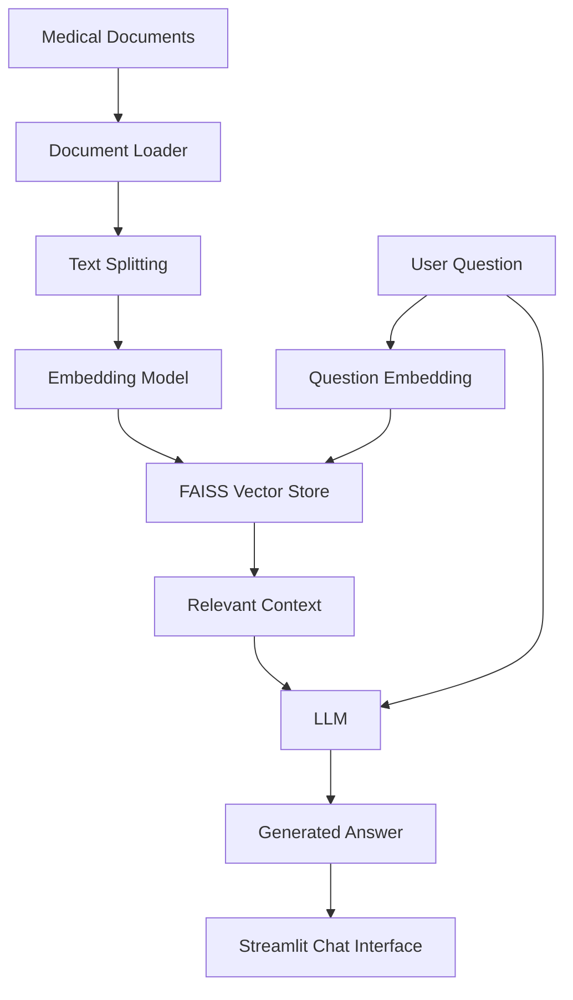

# 🩺 Medical RAG Chatbot

An AI-powered Medical Question Answering Chatbot that uses Retrieval-Augmented Generation (RAG) to answer questions based on medical documents. The application combines document retrieval with a Large Language Model (LLM) to provide context-aware responses through an interactive Streamlit interface.

## 🚀 Features

- 📄 **Medical Document Q&A:** Ask questions about ingested medical documents.
- 🔍 **Retrieval-Augmented Generation (RAG):** Retrieves relevant document passages before generating answers.
- 🧠 **Large Language Model:** Uses an LLM to generate natural-language responses.
- 🗂️ **Vector Search:** Uses FAISS to search document embeddings.
- ✂️ **Document Processing:** Splits documents into chunks for retrieval.
- 💬 **Interactive UI:** Chat with the application through Streamlit.
- 🔐 **Environment Variables:** Configure API keys outside the source code.

## 🏗️ Architecture



## 🛠️ Tech Stack

| Technology | Purpose |
|---|---|
| Python | Core programming language |
| Streamlit | Web interface |
| LangChain | RAG pipeline and LLM integration |
| FAISS | Vector similarity search |
| Hugging Face | Embeddings and model integrations |
| Groq | LLM inference, if configured |
| PyPDF | PDF text extraction, if used by the project |
| python-dotenv | Environment variable management |

> The technologies listed above describe the intended project stack. Check `requirements.txt` and the source code to confirm the exact packages and integrations used in your version.

## 📂 Project Structure

```text
medical-chatbot/
├── app.py
├── requirements.txt
├── .env.example
├── .gitignore
├── README.md
├── data/
│   └── documents/
└── vectorstore/
```

The folder names may differ in your local project. Keep your existing source filenames and directory structure when updating this README.

## ⚙️ Installation and Setup

### 1. Clone the Repository

```bash
git clone https://github.com/YOUR_USERNAME/medical-rag-chatbot.git
cd medical-rag-chatbot
```

Replace `YOUR_USERNAME` with your GitHub username and use your actual repository URL.

### 2. Create a Virtual Environment

**Windows PowerShell**

```powershell
py -m venv .venv
.\.venv\Scripts\Activate.ps1
```

If PowerShell blocks environment activation, run:

```powershell
Set-ExecutionPolicy -Scope Process -ExecutionPolicy Bypass
.\.venv\Scripts\Activate.ps1
```

### 3. Install Dependencies

```powershell
python -m pip install --upgrade pip
python -m pip install -r requirements.txt
```

### 4. Configure API Keys

Create a `.env` file in the project root. Use `.env.example` as a template.

For a Groq-based integration:

```dotenv
GROQ_API_KEY=your_groq_api_key
```

If your source code uses Hugging Face or another provider requiring credentials, configure the corresponding variables as required by that code.

Get API credentials from:

- Groq: https://console.groq.com/keys
- Hugging Face: https://huggingface.co/settings/tokens

Never commit `.env` or publish API keys.

### 5. Add Medical Documents

Place medical PDF files in the document directory expected by your application.

Only use documents that you have permission to process and distribute. If the application relies on a prebuilt vector index, follow the project's indexing code to rebuild it when adding or changing documents.

### 6. Run the Application

If your Streamlit entry point is `app.py`, run:

```powershell
python -m streamlit run app.py
```

Open the local URL shown in the terminal, usually:

http://localhost:8501

If your entry-point filename is different, use that filename instead.

## 💡 Example Questions

You can test the chatbot with questions supported by your source documents, for example:

- What symptoms are described in this document?
- What does the document say about diabetes?
- Summarize the relevant information about blood pressure.
- What prevention measures are mentioned in the source?

Answers depend on the content of the documents indexed by the application.

## 🔎 How RAG Works

1. Documents are loaded and their text is extracted.
2. Text is split into smaller chunks.
3. An embedding model converts chunks into vectors.
4. FAISS indexes the vectors for similarity search.
5. A user question is used to retrieve relevant passages.
6. The retrieved context is passed to the language model.
7. The model generates an answer using the available context.

## 🧪 Testing and Validation

Before publishing changes:

- Confirm that dependencies install successfully.
- Verify that required API keys are configured.
- Check that documents load and text extraction works.
- Confirm that vector search returns relevant passages.
- Test questions with answers present in the source documents.
- Test questions that are not covered by the documents.
- Check how the application handles missing keys and API failures.

Do not claim that automated tests pass unless they have actually been run.

## 🐛 Troubleshooting

### Missing API key

Check your `.env` file and confirm that the variable name matches the source code. Restart Streamlit after changing environment variables.

### ModuleNotFoundError

Activate the correct virtual environment and install the dependencies:

```powershell
python -m pip install -r requirements.txt
```

### Vector store or index error

Check that the index exists at the expected path. If it is missing or incompatible, rebuild it using the project's indexing workflow.

### No relevant documents retrieved

Check the PDF extraction output, chunking configuration, embedding model, and retrieval settings.

### Streamlit command not found

Run the application through Python:

```powershell
python -m streamlit run app.py
```

## ⚠️ Medical Disclaimer

This project is intended for educational and research purposes only. It is not a substitute for professional medical advice, diagnosis, or treatment.

- AI-generated answers may be inaccurate or incomplete.
- Retrieved content may be outdated or irrelevant.
- Always verify medical information with qualified healthcare professionals and reliable sources.
- Do not use the application to make emergency medical decisions.

## 🔐 Security

- Store secrets in environment variables.
- Keep `.env` out of Git.
- Do not upload private patient records or sensitive personal information.
- Review uploaded documents and third-party API data-handling policies.
- Follow applicable privacy and data-protection requirements.

## 🚀 Future Improvements

- Add source citations and document page references.
- Improve retrieval quality with reranking.
- Add automated tests and structured error handling.
- Support multiple document formats.
- Add chat history and session management.
- Evaluate answer quality and hallucination rates.
- Deploy the application using a suitable hosting platform.

## 🤝 Contributing

Contributions and suggestions are welcome.

1. Fork the repository.
2. Create a feature branch.
3. Make and test your changes.
4. Submit a pull request with a clear description.

## 📜 License

Add a `LICENSE` file before specifying a license. Until then, do not assume that the project is licensed for unrestricted reuse or redistribution.

## 📚 References

- [LangChain Documentation](https://docs.langchain.com/)
- [Streamlit Documentation](https://docs.streamlit.io/)
- [FAISS](https://github.com/facebookresearch/faiss)
- [Hugging Face Documentation](https://huggingface.co/docs)
- [Groq Documentation](https://console.groq.com/docs)

---

**Built with Python, RAG, vector search, and generative AI.**
